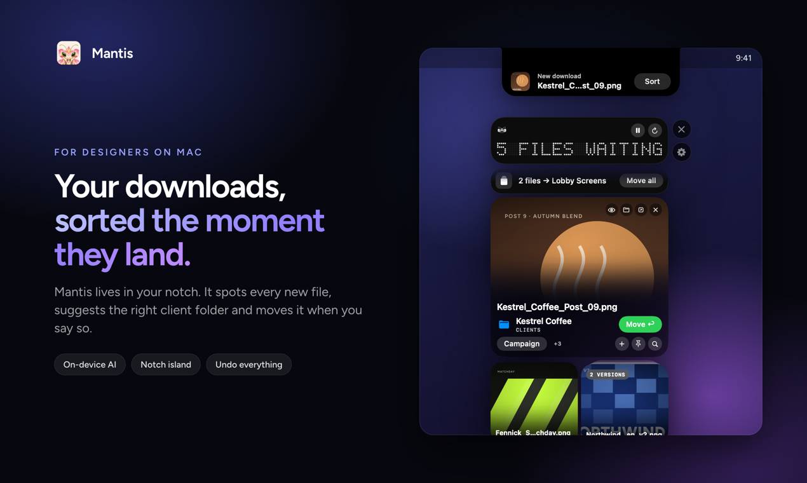
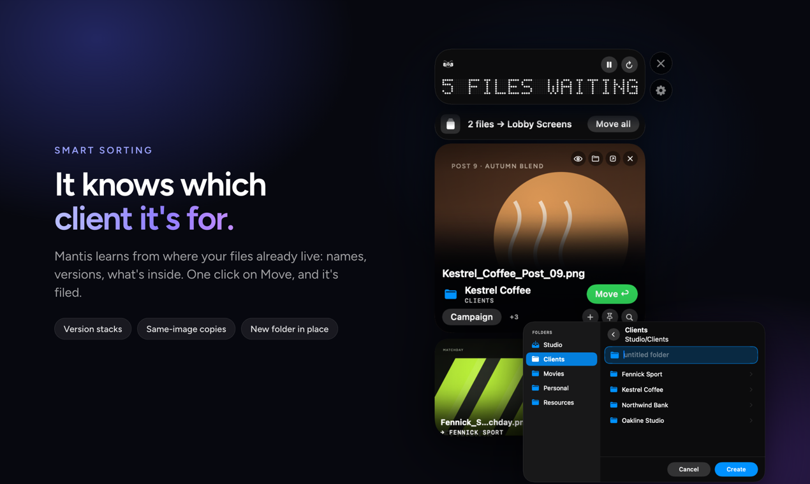
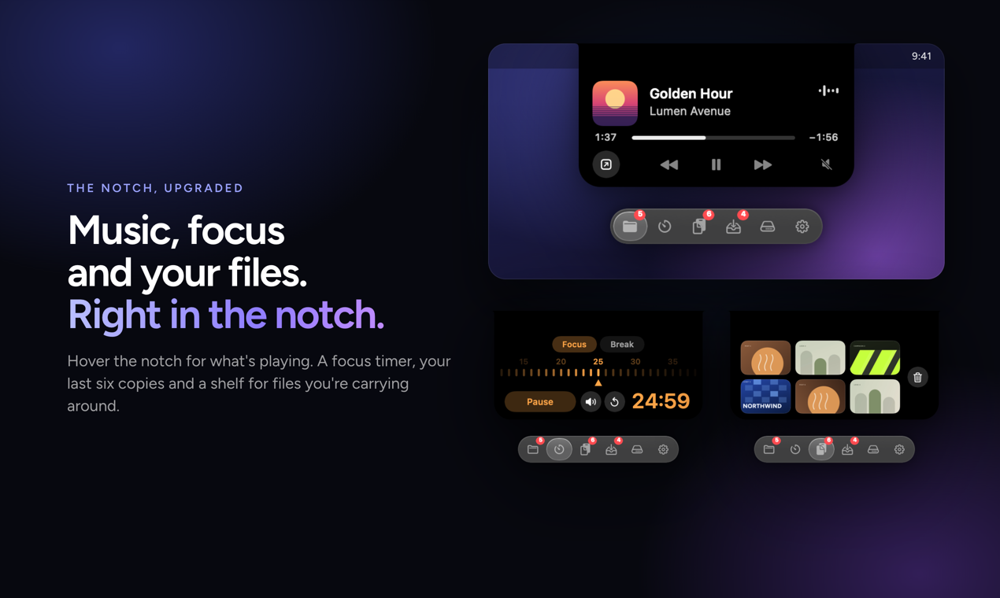
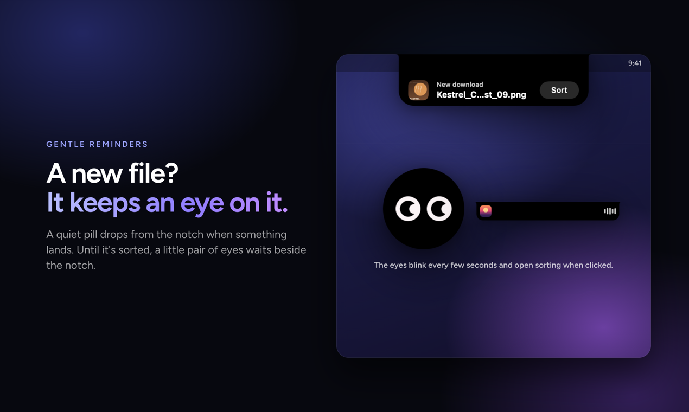
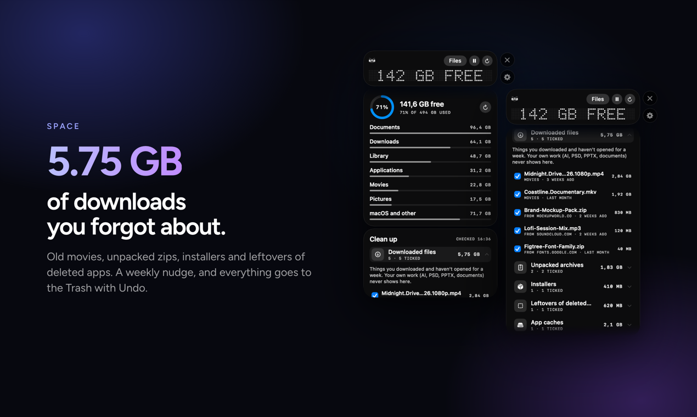
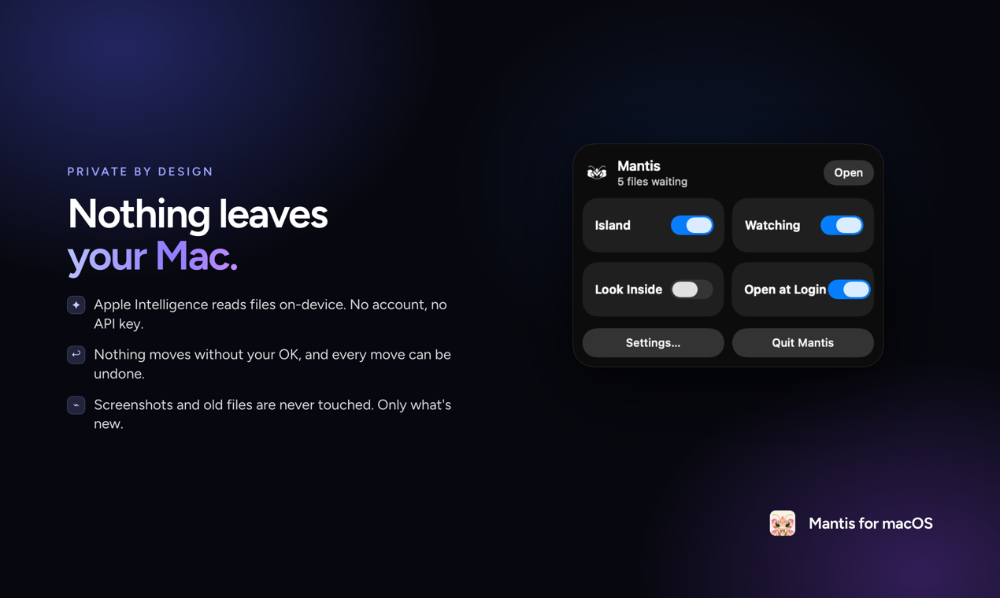

<h1 align="center">Mantis</h1>

<b>Your downloads, sorted the moment they land.</b> A notch companion for designers on Mac.

<a href="https://github.com/hachimkf/mantis/releases/latest"><b>Download Mantis for macOS</b></a>

## What it does

- **Smart sorting.** Every new download or design save gets a folder suggestion, learned from where your files already live. Nothing moves until you press Move, and every move can be undone.
- **Notch island.** Hover the notch to see what's playing. A focus timer, your last six copies and a shelf for files on the move.
- **Gentle reminders.** A notice drops from the notch when something new lands, and a pair of eyes waits beside the notch until it's sorted.
- **Space.** See what fills your disk and clear old downloads, unpacked zips, installers and leftovers. A weekly nudge for downloads you never opened.
- **Private.** Everything runs on your Mac with on-device Apple Intelligence. No account, no API key.

## Install

1. Download `Mantis.dmg` from the [latest release](https://github.com/hachimkf/mantis/releases/latest).
2. Open it and drag **Mantis** onto **Applications**.
3. The first time, macOS may block it: open **System Settings → Privacy & Security** and click **Open Anyway** next to Mantis.

Requires macOS 26 or later. Works best on a MacBook with a notch.

© 2026 Lizartstudio INC.
